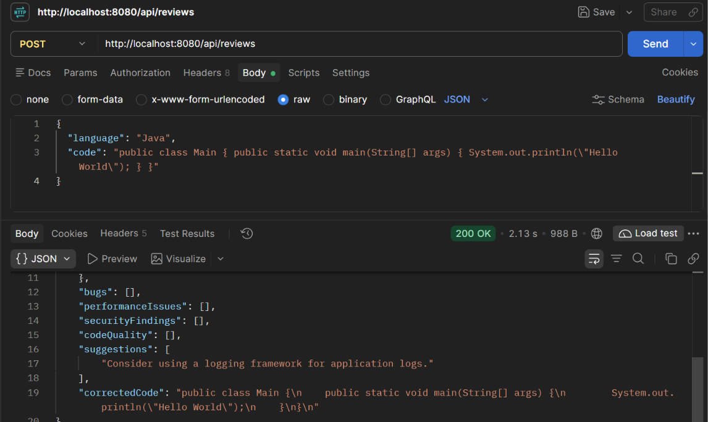
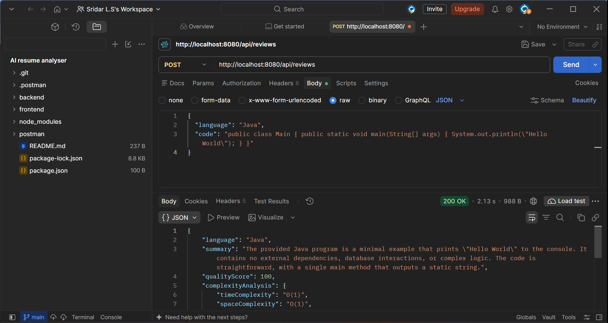

# AI Code Review Assistant

An AI-powered Code Review Assistant developed using Java, Spring Boot, and Groq AI. This application analyzes submitted source code and generates intelligent feedback to help developers identify issues and improve code quality.

## Features

- AI-powered source code analysis
- Automated code quality evaluation
- Code quality score
- Bug identification and suggestions
- Performance analysis
- Security recommendations
- Code improvement suggestions
- Corrected code recommendations
- REST API integration

## Technologies Used

| Technology | Purpose |
|---|---|
| Java | Backend Programming |
| Spring Boot | Backend Framework |
| Groq AI | AI Integration |
| REST API | API Communication |
| Maven | Build Tool |
| Postman | API Testing |
| Git & GitHub | Version Control |

## Project Screenshots

### 1. API Review Result



### 2. Detailed Code Review



## Installation and Setup

### Prerequisites

- Java JDK 17 or above
- Git
- Groq API Key

### Step 1: Clone the Repository

```bash
git clone https://github.com/Sridar124/ai-code-review-assistant.git

cd ai-code-review-assistant
```

### Step 2: Configure Groq API Key

Create an API key through the Groq platform and configure it as an environment variable.

For Windows PowerShell:

```powershell
setx GROQ_API_KEY "your_actual_groq_api_key"
```

Replace the placeholder with your actual API key.

Restart the terminal after setting the environment variable.

**Important:** Never upload your actual API key or credentials to GitHub.

### Step 3: Run the Application

Execute the following command in the project directory:

```bash
.\mvnw.cmd spring-boot:run
```

The application will start at:

```text
http://localhost:8080
```

## API Documentation

### Code Review API

| Property | Value |
|---|---|
| HTTP Method | POST |
| Endpoint | `/api/reviews` |
| Content-Type | `application/json` |

### Sample Request

```json
{
  "language": "Java",
  "code": "public class Main { public static void main(String[] args) { System.out.println(\"Hello World\"); } }"
}
```

### Testing with Postman

1. Start the Spring Boot application.
2. Open Postman.
3. Select the POST method.
4. Enter `http://localhost:8080/api/reviews`.
5. Select Body → raw → JSON.
6. Paste the sample request.
7. Click Send to receive the AI-generated code review.

### Sample API Response

The API returns an AI-generated code review in JSON format, including the analysis and recommendations. Refer to the project screenshots for an actual successful API response.

## Future Enhancements

- Support for multiple programming languages.
- Advanced code security analysis.
- Improved code quality metrics.
- Enhanced code review reports.
- Additional AI-powered development features.

## Author

**SRIDAR L S**

- GitHub: [Sridar124](https://github.com/Sridar124)
- Project Repository: [AI Code Review Assistant](https://github.com/Sridar124/ai-code-review-assistant)

---

*Developed as a practical project to explore Java backend development and AI integration.*